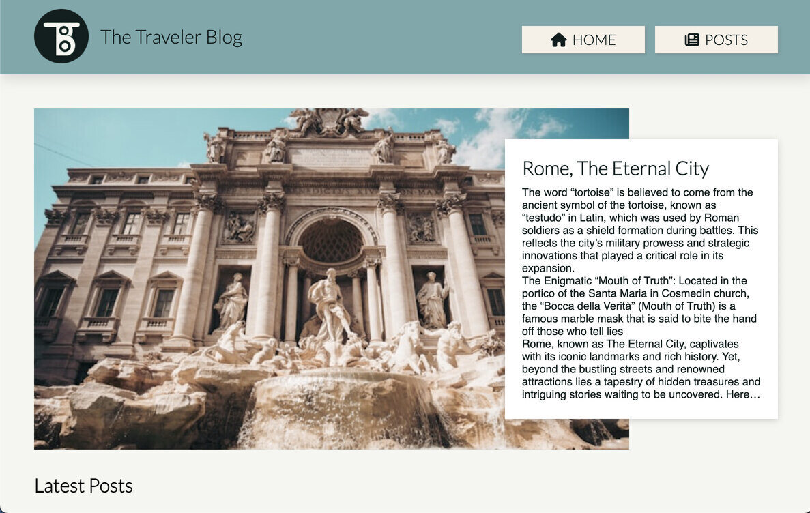

# Project Exam 1


Explore the website by visiting the link: [The Traveler Blog](https://the-traveler-blog.netlify.app/)



## Description

The Traveler Blog is a travel blog built with HTML, CSS and plain JavaScript. It was made as Project Exam 1 at Noroff, by [Nikita Fedorov](https://www.linkedin.com/in/nikita-fedorov-757aaa402/).

The task was to build a website using all the skills learned up to that point in the course. The idea of making a blog came from my own love for traveling. The posts used to come from a WordPress account, but that site is no longer online, so they now come from the Noroff Holidaze API. Every venue in the API is shown as a blog post.

### Features

- Post of Today on the home page, showing the newest post with a 5 star rating
- Carousel with the 5 latest posts
- Asia and Europe sections on the home page
- List of Posts page that shows 10 posts at a time, with a Load More button
- Search posts by the first letters of the title, and sort them newest or oldest first
- Specifics page with the post text and images, click an image to enlarge it
- Loading skeletons while the posts load, and an error message if they fail
- Contact form with validation
- About page with the story behind the blog
- Hamburger menu and a smaller logo on mobile

## Built With

- Language = JavaScript (ES modules)
- Markup = HTML5
- Styling = CSS
- Icons = Font Awesome
- Font = Lato from Google Fonts
- API = Noroff Holidaze API (v2)
- Analytics = Hotjar
- Hosting = Netlify

## How It Works

Every page has its own script in `js/`, loaded as a module. The API url is in `js/constants/constant.js`.
The home page fetches the 100 newest venues and the list page fetches 10 at a time, both skipping the ones without images. The functions in `js/api/` then build the post cards from that data.
The specifics page reads the `id` from the URL and fetches that one venue.

## Project Structure

```
├── index.html         # home page
├── list-of-posts.html
├── specifics.html     # single post page
├── about.html
├── contact.html
├── styles.css
├── pictures/          # logos and page images
└── js/
    ├── api/           # builds the posts on each page
    ├── constants/     # API url
    ├── helper/        # scroll, menu, search, image enlarge and url helpers
    ├── ui/            # loading skeletons, error message, form validation and Hotjar
    └── *.js           # one script per page
```

## Getting Started

### Prerequisites

- A code editor, like VS Code
- A local server, like the Live Server extension for VS Code

There is nothing to install and no build step. The scripts are ES modules, so the pages have to be opened through a local server, not by double-clicking the HTML file.

### Installing

1. Clone the repo:

```bash
git clone https://github.com/Nikita-stud/project-exam-1.git
```

### Running

Open the folder in VS Code and click **Go Live** in the status bar. The site opens at `http://127.0.0.1:5500`.

## Roadmap

- [x] Move the posts from WordPress to the Noroff Holidaze API
- [x] Search and sort the posts
- [ ] Make the carousel move from post to post instead of jumping
- [ ] Change the main colors

## Contributing

This is a finished course project, so I am not planning any big changes. If you find a bug or have an idea, open an issue or a pull request and I will take a look.

## Contact

You can always contact me through the official Noroff portal, or reach me here:

- Nikita on [GitHub](https://github.com/Nikita-stud) and [LinkedIn](https://www.linkedin.com/in/nikita-fedorov-757aaa402/)
